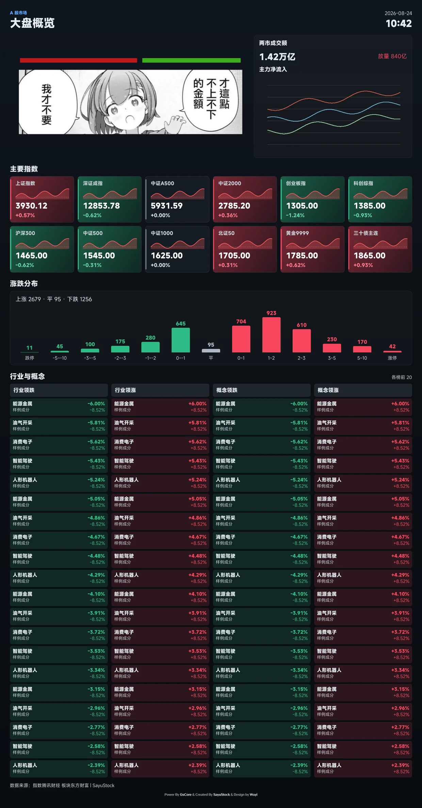
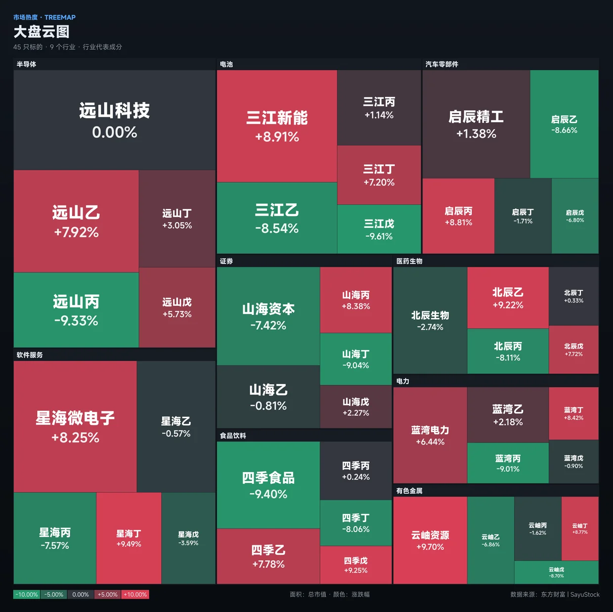
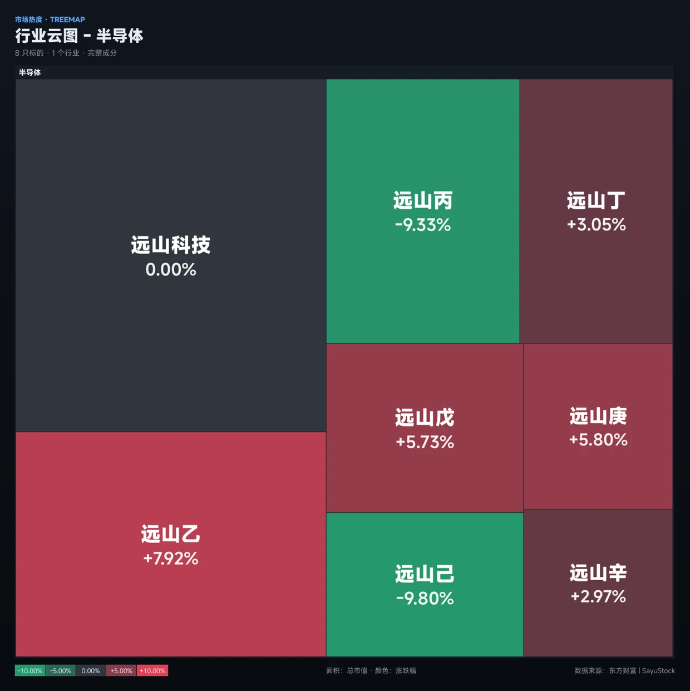
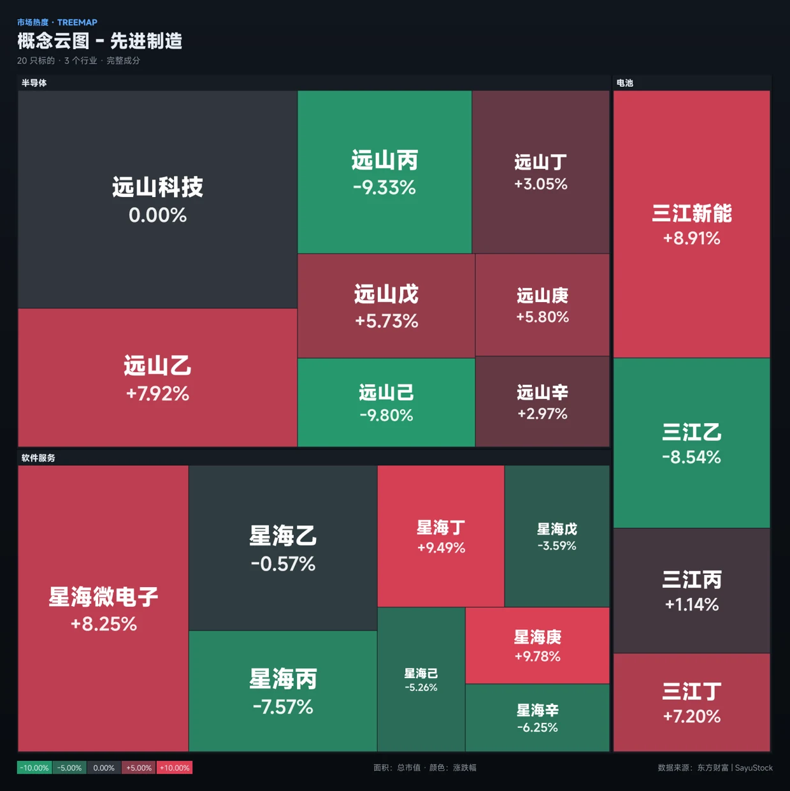
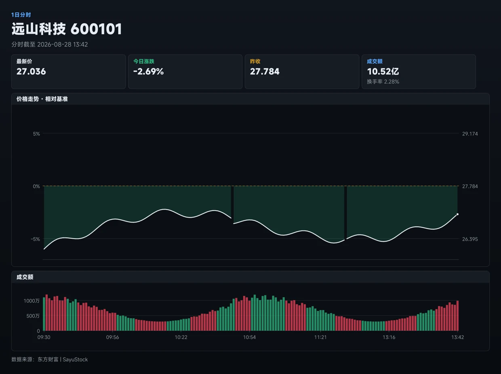
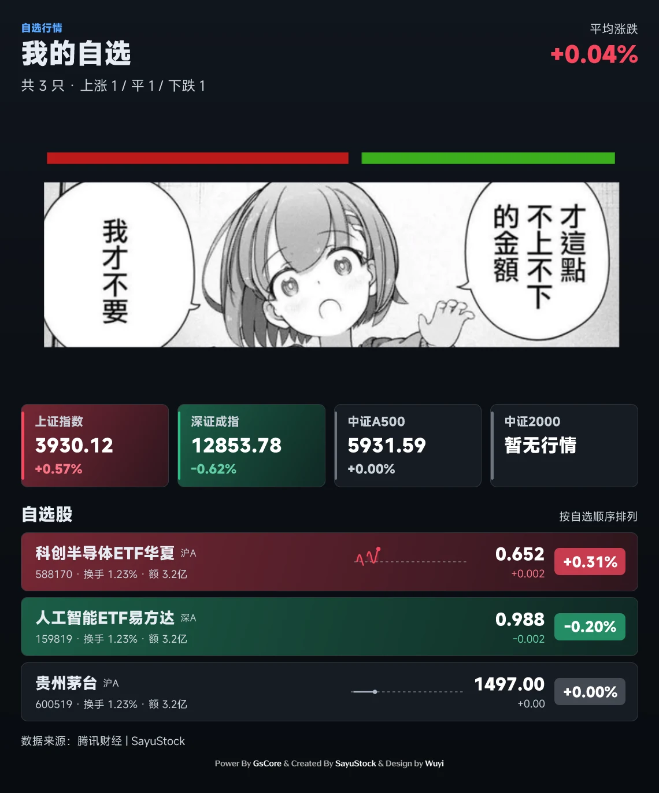
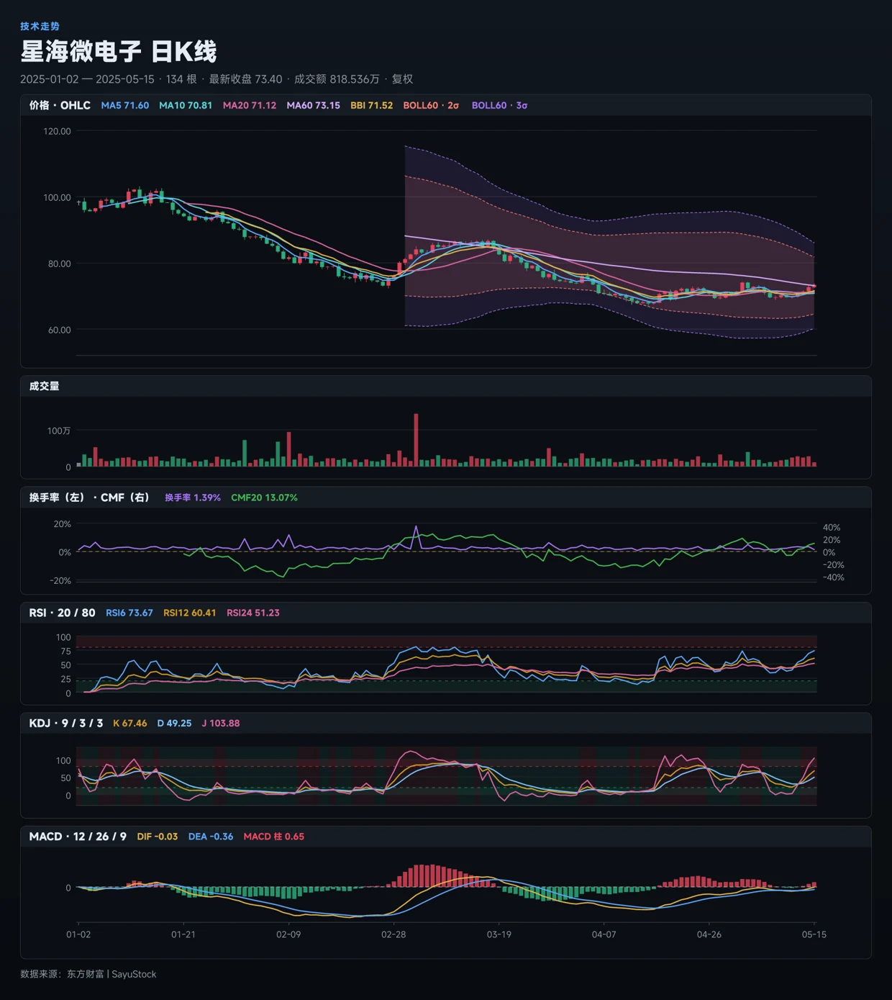
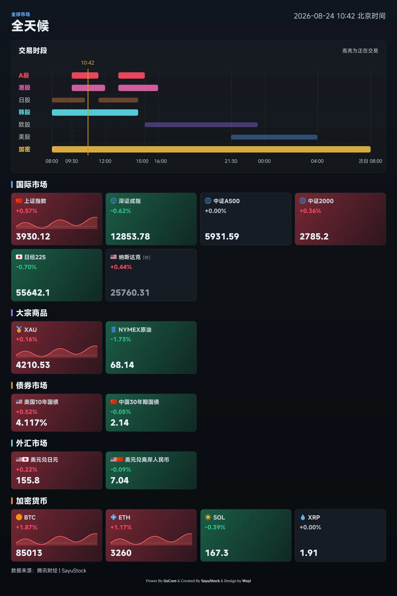
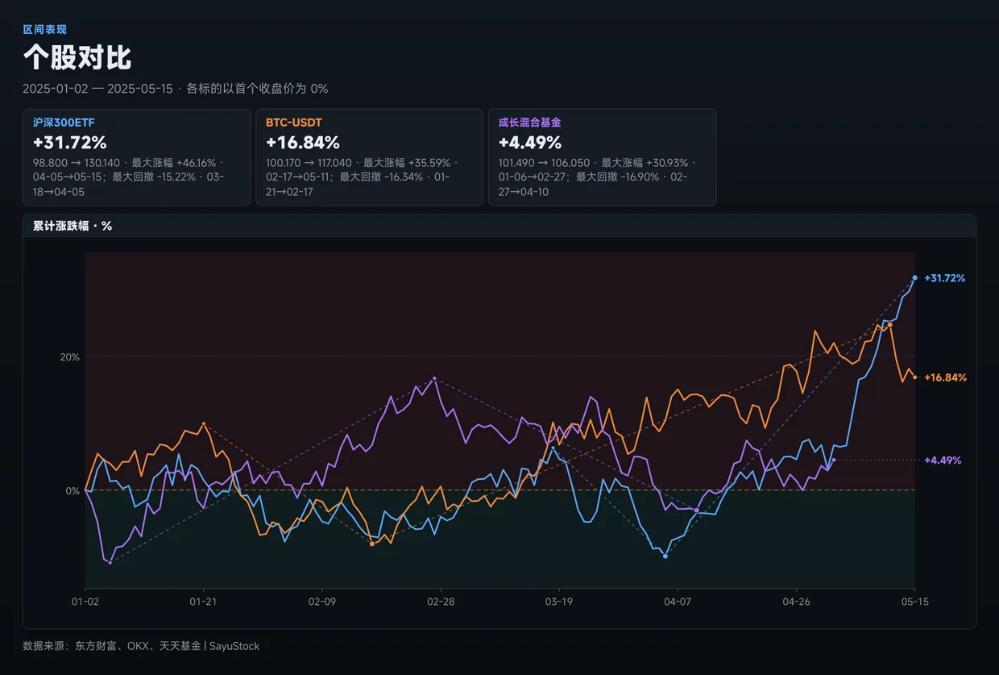
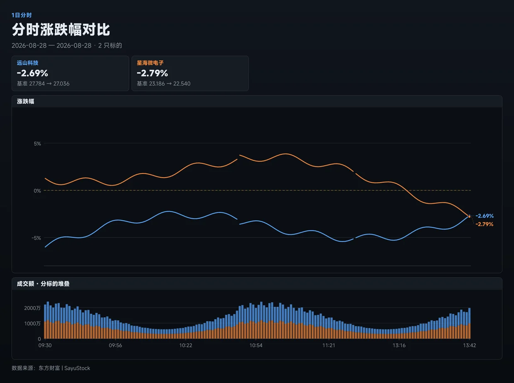

# SayuStock

  

<h1 align = "center">早柚股票 SayuStock 0.8</h1>
<h4 align = "center">🚧支持QQ群/频道、OneBot、微信、KOOK、Tg、飞书、DoDo、米游社、Discord的股票Bot插件🚧</h4>

        <a href="http://docs.gsuid.gbots.work/#/" target="_blank">安装文档</a>

## 丨安装提醒

> **注意：该插件为[早柚核心(gsuid_core)](https://github.com/Genshin-bots/gsuid_core)的扩展，具体安装方式可参考[GenshinUID](https://github.com/KimigaiiWuyi/GenshinUID)**
>
> 支持NoneBot2 & HoshinoBot & ZeroBot & YunzaiBot & Koishi的股票Bot插件

## 丨安装方式
1. 发送`core安装插件SayuStock`
2. 开启 Core 的自动安装依赖，或按插件依赖清单在运行 Core 的 Python 3.12 环境中安装。
3. 发送`gs重启`应用插件。

行情图使用 Jinja 模板和 Core 的公开绘图接口，共享其 PyTakumi 渲染实例与字体缓存，不需要安装 Node.js、npm 或浏览器。
依赖检查和排错见[图片渲染说明](docs/rendering.md)。Playwright 仍服务于雪球自动 Cookie 获取，
使用该功能时继续按其说明安装浏览器。插件仍放在原有 `gsuid_core/plugins/SayuStock/`，
不需要移动配置、用户数据或模拟盘数据库。

## 丨功能

行情与卡片样图由离线合成数据生成，用于展示布局，不代表实时行情。更多样例和验证方法见[绘图说明](docs/rendering.md#页面样例)。

大盘概览

大盘云图 (大盘云图 港股/美股)

行业云图 半导体

概念云图 白酒

个股 沪深300

我的自选 (添加自选)

个股 五日 贵州茅台（5日 / 五日分时，分时线不是K线）

五日分时走东财 trends2 <code>ndays=5</code>（push2his），图上按交易日分隔。

个股 日k 东方财富（周k、月k、年k）

（取消）订阅雪球新闻    (仅限管理员)

全天候

对比个股 A500 沪深300 上证指数 中证白酒

我的个股 / 个股 证券ETF 通信ETF 中证白酒

## 丨感谢&参考

- [Tosuto](https://github.com/tosu) - 绘图 UI 重构与 Jinja + Takumi 渲染迁移
- [qstock](https://github.com/tkfy920/qstock) - 参考部分代码

## 丨其他

+ 如果对本插件有功能建议&Bug报告，欢迎提Issue & Pr，每一条都会详细看过
+ 如果本插件对你有帮助，不要忘了点个Star~
+ 本项目仅供学习使用，请勿用于商业用途
+ [爱发电](https://afdian.com/a/KimigaiiWuyi)
+ [GPL-3.0 License](https://github.com/KimigaiiWuyi/SayuStock/blob/master/LICENSE)
