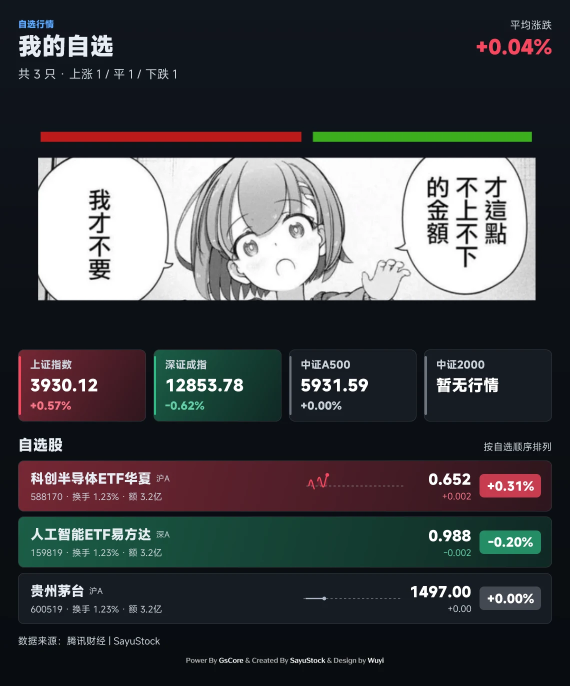
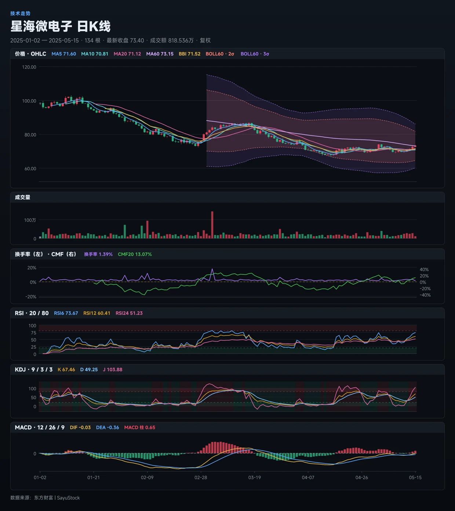
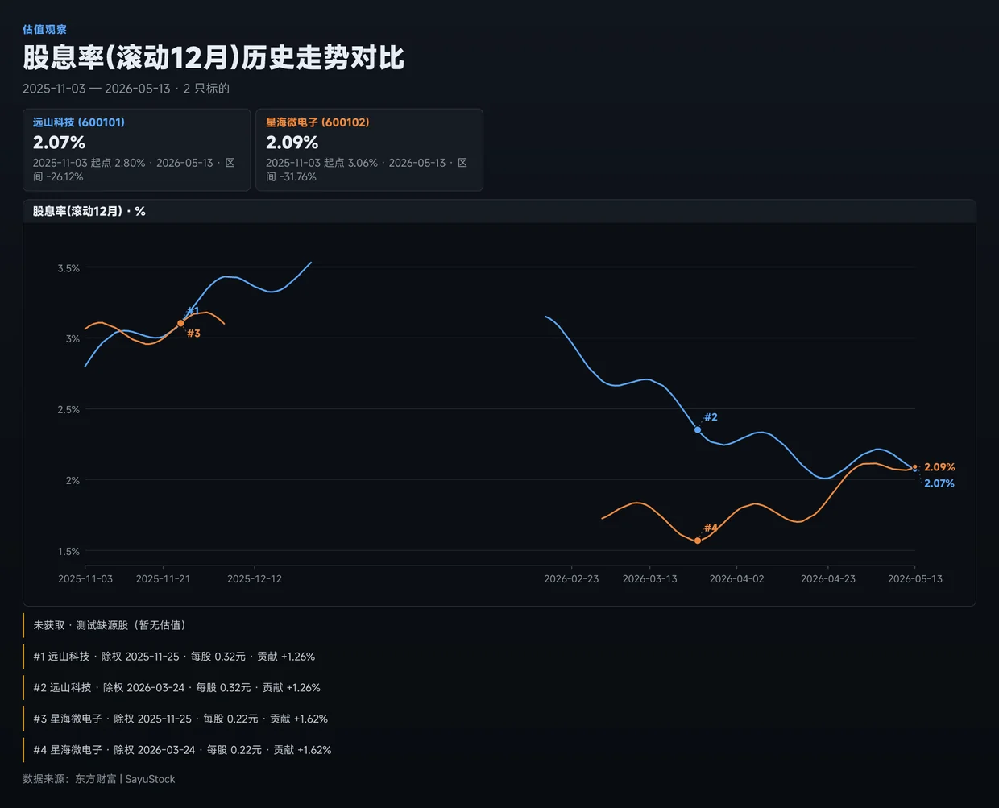
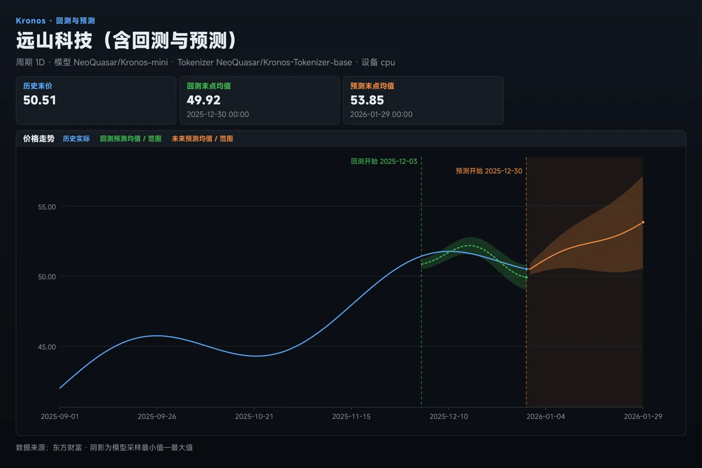
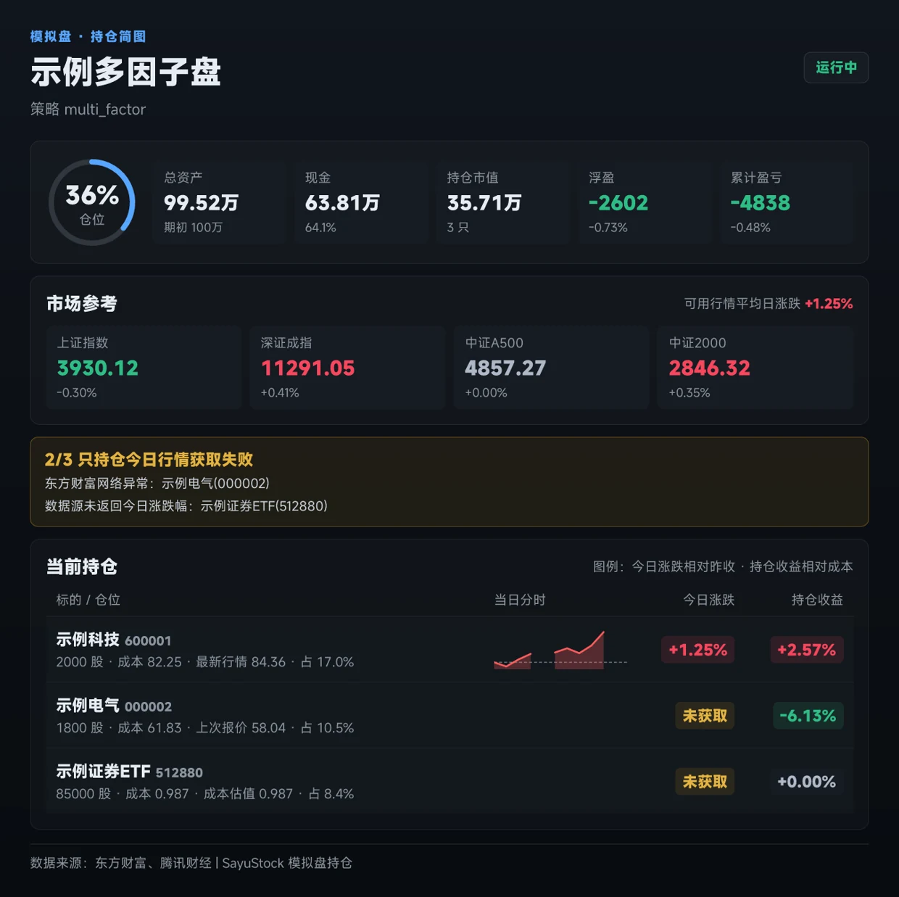
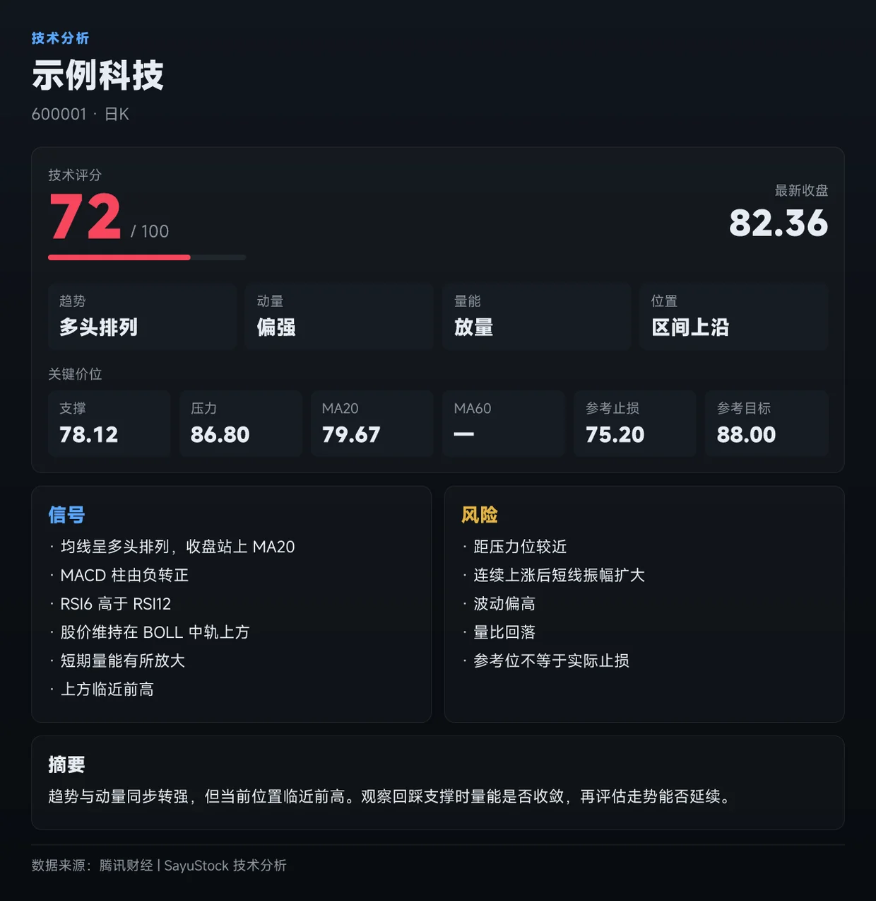

# 图片渲染：Takumi + Jinja

SayuStock 的行情图和业务卡片由 Jinja 模板生成 HTML/SVG，再由 Node Takumi 输出 PNG。
行情仍来自 `get_market()`，指标仍由 `utils/indicators.py` 计算；命令、配置和数据目录不变。
插件继续放在 `gsuid_core/plugins/SayuStock/`，无需调整 Core 的目录结构。

## 安装绘图运行时

在运行 Core 的同一台机器安装 **Node.js 24.x（含 npm）**，然后在插件根目录执行：

```sh
node tools/install-render-runtime.mjs
```

脚本使用仓库锁文件安装 `@takumi-rs/core` 和 `@takumi-rs/helpers` **2.14.0**，
用 Core 自带的 MiSans 字体实际出图成功后，才切换到新运行时。
安装目录为 `<Core>/data/SayuStock/render-runtime/current`。旧版本保留为同目录下的
`previous-*`，失败的安装不会覆盖正在使用的版本。升级插件不会删除这些资源。

Core 服务的 PATH 也必须能找到 Node 24。若服务与终端的 PATH 不同，设置服务环境变量
`SAYUSTOCK_RENDER_NODE` 为 Node 可执行文件的绝对路径，然后重启 Core。
容器使用预装 Node 24 的镜像，并持久化 Core 的 `data/`。

独立 clone 或自定义资源目录可指定路径：

```sh
node tools/install-render-runtime.mjs \
  --runtime-dir /path/to/Core/data/SayuStock/render-runtime \
  --font /path/to/Core/gsuid_core/utils/fonts/MiSansVF.ttf
```

自定义安装位置时，Core 进程设置 `SAYUSTOCK_RENDER_RUNTIME` 指向安装后的 **current** 目录。
若 Node 发行包没有附带 npm，可用 `--npm-cli /path/to/npm/bin/npm-cli.js` 指定已有的 npm。
安装只在执行此脚本时联网；导入插件或响应消息不会下载软件。

绘图不再启动浏览器。**Playwright 仍用于雪球自动 Cookie 获取**，使用该功能时仍需
安装对应浏览器；Core 自己的帮助、Markdown 等图片沿用 Core 的渲染入口。

## 修改页面

- `SayuStock/render/templates/`：Jinja 页面、公共样式和 SVG 模板。
- `SayuStock/render/palette.py`：颜色单源。红涨、绿跌、灰色平盘；黄色表示警告或失败。
- `SayuStock/render/charts.py`：坐标变换、路径和矩形树图几何，不计算业务指标。
- 页面模块：接收上游领域模型或有类型的展示结构，组织标签、图表和模板上下文。

```python
from SayuStock.render import render_html
from SayuStock.render.chart_page import ChartPage, Panel, page_html

page = ChartPage(
    title="示例个股", eyebrow="行情", subtitle="暂无有效分时数据",
    panels=[Panel(label="分时", height=260, axis=[], empty="行情暂缺")],
    footer="离线示例",
)
png = await render_html(page_html(page), width=1240, scale=1.5, label="个股")
```

`width` 是 CSS 像素，`scale` 是输出倍率，内容决定高度。Jinja 开启自动转义和
`StrictUndefined`；行情名称等普通文字不要标记为 `safe`。
SVG 几何只能由本地构造器生成。模板不执行 JavaScript，也不依赖浏览器布局。

每个进程至多并行渲染两张图，总时限 45 秒，包含等待名额的时间。
超时或取消会结束所属绘图进程并清理临时文件。运行时缺失或出图失败抛出
`RenderError`，业务入口保留已生成的文字，并返回明确错误，不能把失败写进图片缓存。

## 验证

普通单测不要求联网行情。要运行真实 Node 出图测试，安装运行时后设置：

```sh
export SAYUSTOCK_REQUIRE_RENDER_RUNTIME=1
export SAYUSTOCK_RENDER_EVIDENCE_DIR=/path/to/render-evidence
pytest test/ -q
```

PowerShell 使用 `$env:SAYUSTOCK_REQUIRE_RENDER_RUNTIME = '1'` 设置同名变量。
`SAYUSTOCK_RENDER_EVIDENCE_DIR` 用于保存测试样图；样图使用合成数据，不代表实时行情。
CI 的完整测试安装运行时并开启强制出图，缺依赖或渲染失败会使检查失败。

检查 PNG 中的字体、完整名称、数值精度、日期轴、末端标签和失败行；单测通过不能代替
查看图片。改变模板后更新相应页面测试，保留指标、AI 文字与冷/热缓存行为的断言。

## 页面样例

下图由测试中的合成数据生成。完整 PNG（包含空态、部分失败、三股缺测、90 根跨年日 K）
由 CI 的 `takumi-render-evidence` artifact 提供；这里保留缩放后的展示图。
Kronos 示例使用预先构造的预测数组，验收展示和缓存链路，不下载或运行模型权重。

<details><summary>我的自选：全宽表情包，下方四张指数卡</summary>



</details>

<details><summary>K 线与股息率：共享指标、独立标签与缺测断点</summary>




</details>

<details><summary>Kronos：回测与预测区间</summary>



</details>

<details><summary>模拟盘与技术分析</summary>




</details>

## 回退

先停止 Core，再把 `current` 重命名保留，将需要恢复的 `previous-*` 改名为 `current`，
随后启动 Core。源码回退使用已知可用的插件提交；旧版本依赖按该版本安装说明恢复。
不要删除 `data/SayuStock/data/` 中的行情 JSON、用户自选或模拟盘数据库。
